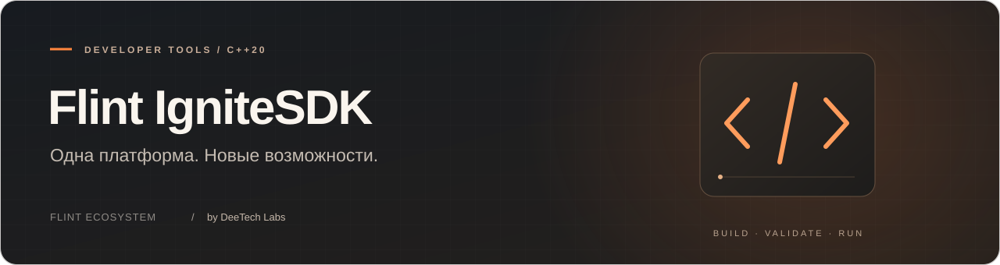

<p align="center">
  
</p>

<p align="center">
  <a href="LICENSE"></a>
  
  
</p>

<p align="center">
  <a href="#быстрый-старт">Быстрый старт</a> &nbsp; · &nbsp; <a href="#документация">Документация</a> &nbsp; · &nbsp; <a href="#лицензия">Лицензия</a> &nbsp; · &nbsp; <a href="#участники">Участники</a>
</p>

<p align="center">
  <a href="docs/en/README.md">English version</a> &nbsp; / &nbsp;
  <a href="https://flint.deetech.ru/">Сайт экосистемы</a> &nbsp; / &nbsp;
  <a href="https://github.com/DeeTech-Labs">DeeTech Labs</a>
</p>

---

Общая платформа C++20 для FlinT OS, Flare Preview и локального симулятора. Этот репозиторий — единственный источник переносимого Runtime, контрактов пакетов, компилятора, SDK и тестов. OS и Flare подключают закреплённые коммиты как Git-подмодуль `platform/`; сгенерированных копий исходников нет.

Публичные версии OS API, Face SDK, Ignite и Companion остаются **1**. Отдельно проверяются ревизия контракта разработки и идентификатор сборки: совпадение версии 1 не доказывает совместимость бинарников.

## Что внутри

- **Core и Runtime.** Общие службы, исполнение приложений и рендерер для OS, Flare и симулятора.
- **Контракты.** Формат Ignite, бинарный Companion, API и реестр разрешений.
- **Инструменты.** Компилятор пакетов, валидатор и детерминированная симуляция.
- **Примеры и тесты.** Готовые проекты, проверки установки, отката и ограничений Lua.

## Быстрый старт

```sh
python3 -m pip install Pillow
cmake -S . -B build/debug -DCMAKE_BUILD_TYPE=Debug
cmake --build build/debug
ctest --test-dir build/debug --output-on-failure
python3 tools/compile_ignite.py examples/pc-monitor/project.json /tmp/pc-monitor.ignit
```

CMake создаёт реестры, системные пакеты и примеры в каталоге сборки; исходники не переписываются. Прямые генераторы по умолчанию используют `build/generated/`.

Подробные команды установки, API Lua и подключение SDK — в [руководстве разработчика](docs/ru/SDK.md).

## Исполнение приложений

Lua 5.4.9 работает в ограниченном Runtime на компьютере, в симуляторе и проверенной конфигурации Spark. Фоновые службы пока не поддерживаются.

## Документация

- [Руководство SDK и Lua](docs/ru/SDK.md).
- [Архитектура и бинарные форматы](docs/ru/ARCHITECTURE.md).
- [Пример PC Monitor](docs/ru/PC-MONITOR.md).

---

## Лицензия

**Runtime — PolyForm Noncommercial 1.0.0; SDK/API — Apache-2.0.** Точная область действия указана в [LICENSE](LICENSE). [Разрешение разработчикам](docs/ru/SDK-DEVELOPMENT-PERMISSION.md) охватывает разработку бесплатных и платных независимых Ignite; [разрешение сообществу](docs/ru/COMMUNITY-EXCEPTION.md) — любительские устройства по себестоимости.

[Все условия лицензирования](docs/ru/LICENSING.md) · [Уведомления о компонентах](NOTICE).

## Участники

Спасибо всем, кто помогает развивать **Flint IgniteSDK**: пишет код, проверяет сборки, находит ошибки, улучшает документацию и переводы.

<a href="https://github.com/DeeTech-Labs/Flint-IgniteSDK/graphs/contributors">
  
</a>

<p><sub>Flint IgniteSDK · Часть экосистемы FlinT · Разработка DeeTech Labs</sub></p>
