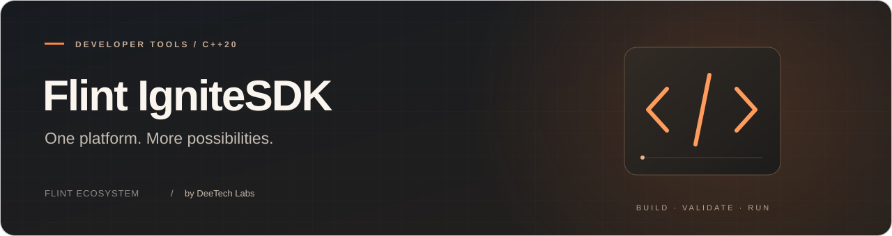

<p align="center">
  
</p>

<p align="center">
  <a href="../../LICENSE"></a>
  
  
</p>

<p align="center">
  <a href="#quick-start">Quick start</a> &nbsp; · &nbsp; <a href="#documentation">Documentation</a> &nbsp; · &nbsp; <a href="#license">License</a> &nbsp; · &nbsp; <a href="#contributors">Contributors</a>
</p>

<p align="center">
  <a href="../../README.md">Русская версия</a> &nbsp; / &nbsp;
  <a href="https://flint.deetech.ru/">Website</a> &nbsp; / &nbsp;
  <a href="https://github.com/DeeTech-Labs">DeeTech Labs</a>
</p>

---

Shared C++20 platform for FlinT OS, Flare Preview and the local simulator, developed by DeeTech Labs. This repository is the single source for the portable Runtime, package contracts, compiler, SDK tools and tests. OS and Flare consume pinned commits as `platform/` Git submodules; no generated source copies are maintained.

Public OS API, Face SDK, Ignite and Companion versions remain **1**. Development contract revision, build identity and capabilities are checked separately: matching v1 is not sufficient for binary compatibility.

## Quick start

Run from the SDK repository root:

```sh
python3 -m pip install Pillow
python3 tools/generate_registry.py
python3 tools/build_system.py
cmake -S . -B build/docs-sdk -DCMAKE_BUILD_TYPE=Debug
cmake --build build/docs-sdk --config Debug
ctest --test-dir build/docs-sdk --output-on-failure -C Debug
python3 tools/compile_ignite.py examples/pc-monitor/project.json build/pc-monitor.ignit
```

[Standalone installation, Lua and pinned consumers](SDK.md). [Architecture, formats, security and limits](ARCHITECTURE.md). [PC Monitor example](PC-MONITOR.md).

## License

This is a [mixed-license repository](../../LICENSE). Own Core/Runtime, system packages and tests use PolyForm Noncommercial 1.0.0; own public headers/APIs in `include/`, specifications in `spec/`, examples in `examples/` and separable tools in `tools/` use Apache-2.0. Third-party fonts and libraries retain their licenses. Linked Runtime binaries do not become Apache-2.0 because their wrapper source is permissively licensed.

The [community exception](COMMUNITY-EXCEPTION.md) permits hobby devices at documented cost without profit. The [developer permission](SDK-DEVELOPMENT-PERMISSION.md) permits validators, simulators and previews for free and paid independent Ignite development. It does not authorize commercial Runtime embedding or resale.

## Current limits

Lua 5.4.9 is the only application language. The bounded Runtime works in host builds, the simulator and the validated Spark firmware configuration. Background services run in isolated VMs with explicit grants and bounded model admission; physical resource acceptance is separate. Host tests do not establish device memory headroom, hardware reliability or battery life.

Maintained sources use four spaces without tabs, following `.editorconfig` and `.clang-format`. Generated font data is not manually reformatted.


## Documentation

[Audience index](INDEX.md) · [First application](APP-QUICKSTART.md) · [Contributing](CONTRIBUTING.md).

[Audience index](INDEX.md) · [First application](APP-QUICKSTART.md) · [Contributing](CONTRIBUTING.md).

[Guides and licensing](LICENSING.md).

## Contributors

Thank you to everyone who contributes code, tests, bug reports, documentation and translations to **Flint IgniteSDK**.

<a href="https://github.com/DeeTech-Labs/Flint-IgniteSDK/graphs/contributors">
  
</a>

<p><sub>Flint IgniteSDK · Part of the FlinT ecosystem · Developed by DeeTech Labs</sub></p>
