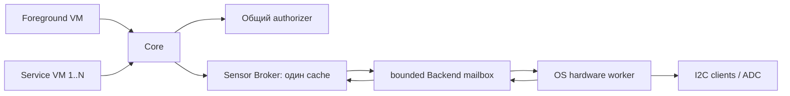

# Разработка общей платформы

[Индекс](README.md) · [English](../en/PLATFORM-GUIDE.md) · [CONTRIBUTING](../../CONTRIBUTING.md)

## Границы и путь данных

SDK владеет Core/Runtime/ServiceRuntime, authorizer, broker, package transactions,
Lua sandbox, codecs, compiler и генерацией. OS владеет драйверами, общей шиной,
аппаратным расписанием/восстановлением и TOML. Flare владеет UI согласий, транспортной
оркестрацией, Studio/Preview и управляемыми виртуальными данными. Не копируйте эти
реализации между проектами. Registry — перечень контрактов, не таблица готовых backend.

Core owner loop последовательно исполняет VM. `HostBinding` несёт Core-issued
InstanceKey; host не извлекает service principal из foreground `runtime_`. Package
generation определяется проверенным установленным объектом; publisher не является подписью.
Worker не вызывает Lua/Core lifecycle: уведомляет владельца, передаёт bounded snapshots.
Все I2C клиенты, включая touch/RTC, принадлежат worker; lock не удерживается при I2C/Flash/Lua.
Simulation использует тот же Core и `sensors::Simulation`, controlled monotonic clock;
remote Preview читает device scene, не запускает вторую Lua VM для remote data.

## Добавить логический канал или источник

Для новой физической реализации существующего канала меняйте OS backend/TOML,
а не публичный app API. Source metadata нормализуется на backend boundary, затем
Broker хранит authoritative cache, фильтрует разрешённые каналы и объединяет demand.
Детерминированный выбор, generation, единицы и recovery — [Sensor contract](SENSORS.md).

Новый логический канал — shared breaking change: `include/flint/sensors.h`,
`spec/sensors.json`, `tools/generate_registry.py`, `src/sensors.cpp`, Lua typed conversion,
`sensor_simulation.h`, permissions spec/authorizer, compiler validation, protocol/Companion
и оба consumers. Не добавляйте строковую JSON сериализацию на горячем пути. Обновите
contract revision, bounds и tests/sensors.cpp, sensor_core, sensor_tooling, Flare sensor_sessions;
OS hardware acceptance отдельно. [Добавление драйвера OS](https://github.com/DeeTech-Labs/FlinT-OS/blob/main/docs/ru/development/extending.md).

## Добавить app operation / permission / protocol method

1. Проверьте `src/lua_app.cpp`, `app_api.h`, `Runtime`/`ServiceRuntime` и Core bridges:
   возможно, контракт уже существует. Сначала определите owner, permission, contexts,
   result/error, quotas и cancellation, затем интерфейс.
2. Shared permission добавляйте в `spec/permissions.json`, method в `spec/services.json`;
   кодеки и Method enum меняются согласованно. Запустите generation, не правьте generated
   registry вручную. Новое имя само по себе не включает capability backend.
3. Core проверяет component declaration и live grants. Privileged factory operations
   требуют установленного factory provenance. Сторонняя VM не создаёт action token,
   principal и permission dialog. Persistent service calls проходят доверенный Core.
4. Новые async данные связывайте с InstanceKey/package generation; stop/revoke удаляют
   pending delivery. Coalesce повторные обновления; задайте явный предел очереди.
5. Обновите native API budget, стоимость memory/stack и loading-phase prohibition.
   Service native calls должны быть bounded/nonblocking: hook не прерывает C callback.
6. Тестируйте malformed inputs, denial/revoke перед delivery, stale handles, switch/
   pause/crash/update, quota/flood и оба транспорта. [Форматы](ARCHITECTURE.md),
   [генерированный registry](REGISTRY.md), [service wire](BACKGROUND-SERVICES.md).

## Scheduler и память

`core_background.cpp`, `core_background_state.h` и `service_runtime.cpp` реализуют
admission, slots, lifecycle, round-robin и общий service pool. Foreground/input имеют
приоритет; service без событий/timer не просыпается для собственного polling.
У foreground отдельные существующие budgets. Резервировать полный service quantum
нужно до извлечения событий; недостаток общих tokens откладывает работу. Individual
превышение завершает только виновный instance. Pause/stop запрещают новые операции
до cancellation; даже ошибка stop callback не удерживает VM. Fault не перезапускается
автоматически в текущем Core. Считать только Lua heap недостаточно: учитываются native
wrapper, manifest, source loading, inbox/shared state/flush и резерв foreground/OS.
Измерения и ограничения — [services](BACKGROUND-SERVICES.md).

## Package update, данные и recovery

`storage.cpp` валидирует header/index/hash/manifest; `PreparedInstall::advance` разбивает
работу. Core останавливает service instances и отзывает grants перед заменой/удалением;
новые permissions не выдаются автоматически. После durable publication disconnect не
доказывает отмену: перечитайте каталог. Не удаляйте incompatible installed objects как
повреждённые. User data/grants и recovery рассматриваются отдельно от breaking ABI.
App kv и shared state имеют разные форматы/политику; CRC не является аутентификацией.
Physical power-loss durability не доказывается mock filesystem tests.

## Согласовать SDK и потребителей

Сначала измените owning SDK, запустите Lua/no-Lua tests, compiler/examples и bounds tests.
При изменении формата обновите `ContractRevision` и соответствующий формат; nominal
versions меняются только при изменении их собственного envelope/framing. Затем проверьте
OS/Flare через явный `FLINT_PLATFORM_DIR` и после разрешённого commit закрепите этот
конкретный SHA в обоих `platform/`. Соседний checkout не обновляет submodule автоматически.
Наконец повторите сборку по обычному pinned пути. Не копируйте документацию SDK в потребителей: используйте ссылки на owning project.
Pin обновляйте намеренно вместе с проверенной интеграцией.

## Проверка расширения

Минимум — [CONTRIBUTING](../../CONTRIBUTING.md); матрица подсистем выбирает дополнительные
tests. Для Core/Runtime запускайте app_api, sensor_core, background_core, service_isolation;
для contract/compiler — contracts, sdk_workflow, registry_validation, package_interop;
для lifetime/storage — async_install и generation_isolation. `ctest -N` показывает реальные
имена выбранной сборки. Host/ESP32 build не подтверждают IRQ timing, stack watermark,
PSRAM/DMA, current consumption или поведение при отключении питания.
